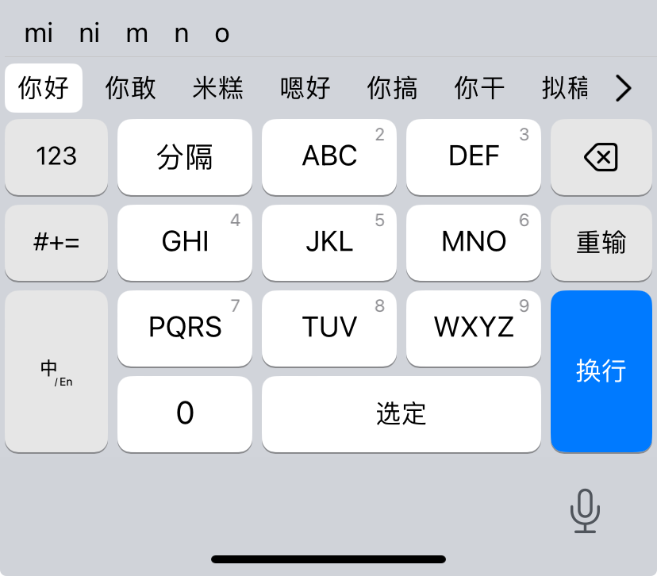

# T9_skin_Short_press_ios

元书输入法（Hamster3）的 T9 九键皮肤，包含 T9 拼音、数字、26 键英文三种键盘，提供浅色 / 深色两套主题，适配 iPhone 竖屏与横屏。



## 整体设计

- **三种键盘总高度一致**：T9 拼音、数字、26 键都使用同一套顶部区域（预编辑区 + 拼音音节栏 + 候选词栏），总高度竖屏 **319**、横屏 **263**。键盘之间切换时高度不变，没有落差感，连续来回切换也不卡顿；在 T9 打字中切到其他键盘，候选词仍显示在候选栏里，不会叠到按键上。
- **顶部区域**（从上到下）：

  | 区域 | 高度 |
  |---|---|
  | 预编辑区（显示输入码） | 25 |
  | 拼音音节栏 | 36 |
  | 分隔线 | 0.5 |
  | 间隔 | 1.5 |
  | 横向候选词栏 | 40 |
  | **工具栏合计** | **78** |

- **按键区**：竖屏 216、横屏 160。
- **展开候选不跳动**：点候选词栏右侧的 `›` 展开纵向候选时，顶部拼音音节栏与常态使用完全相同的行高和位置，展开 / 收起时音节栏不会被压缩或跳动（与 iOS 原生输入法一致）。
- **手势约定**：按键正上方的灰色小字 = 上滑，正下方的灰色小字 = 下滑，中间大字 = 点击。T9 拼音键盘与 26 键英文键盘统一遵循这一约定；上滑多为数字和位置偏高的符号（`"` `'`），下滑多为位置偏低的标点（`,` `;` `_`）和编辑操作。
- **编辑操作**：两种键盘都可以靠滑动完成光标移动、全选、复制、粘贴、剪切、清空、撤销、换行；九键的清空 / 撤销在删除键上滑 / 下滑，详见各键盘的说明。
- **配色**：浅色模式字母键白色、功能键灰色；深色模式字母键深灰、功能键更深的灰；回车蓝色为 `#007AFF`（浅色）/ `#0A84FF`（深色）。

## T9 拼音键盘

### 竖屏布局（4 行 × 5 列）

| 左列 | 第 2 列 | 第 3、4 列 | 右列 |
|---|---|---|---|
| `123` | `1` | `2` `3` | 退格 |
| `#@¥` | `4` | `5` `6` | `重输` |
| `ABC`（占 2 行） | `7` | `8` `9` | 回车（占 2 行） |
| ↑ | `0` | 空格（占 2 列） | ↑ |

- `123` 切数字键盘，`#@¥` 切符号键盘，`ABC` 切 26 键英文键盘。

### 横屏布局

- 键盘分为左右两半，中间留白。
- **左半区**：纵向符号列 + 纵向候选列表。
- **右半区**：
  - 左侧：纵向符号列 + `#@¥`
  - 中间：`1`–`9` 三行，底行为 `123` / 空格 / `ABC`
  - 右侧：退格 / `重输` / `0` / 回车

### 按键说明

- **`1` 键**：键面中间显示 `，`，正上方显示 `1`，正下方显示 `？`（与 `2`–`9` 键上下对称）
  - 常态：点击输入 `，`，上滑输入 `1`，下滑输入 `？`
  - 打字中（有预编辑）：键面变为「分隔」，点击用于 T9 分词
- **`2`–`9` 键**：键面中间显示字母组（`ABC`、`DEF`…），正上方显示数字，正下方显示下滑功能；点击输入拼音编码，上滑直接输入对应数字
- **`2`–`9` 键下滑**：快捷编辑操作

  | 按键 | 下滑 | 按键 | 下滑 |
  |---|---|---|---|
  | `2` ABC | 光标到行首 | `6` MNO | 粘贴 |
  | `3` DEF | 光标到行尾 | `7` PQRS | 换行 |
  | `4` GHI | 全选 | `8` TUV | 剪切 |
  | `5` JKL | 复制 | `9` WXYZ | Tab |
- **`0` 键**：白色字母键底色；上滑输入 `0`
- **空格**：打字中键面显示「选定」，点击上屏首选；上滑为「次选上屏」
- **退格**：长按连续删除；上滑「清空」输入框里的全部文字，下滑「撤销」上一步编辑（如误清空）。键面正上方 / 正下方有提示，只在九键生效，26 键和数字键盘的删除键不变
- **`重输`**：清空当前拼音输入
- **回车**
  - 文字随输入框类型显示（换行 / 发送 / 前往 / 搜索 / 完成…），上滑输入换行
  - 浅色模式：常态灰色，开始输入拼音（出现预编辑）后锁定为蓝色并保持提醒，蓝色状态文字同样随输入框类型变化
  - 深色模式：始终为灰色，只保留动态文字

### 候选栏

- **分隔线常显**：刚打开九键、还没输入拼音时，拼音栏与候选词栏之间的分隔线也会显示（与 iOS 原生九键一致）；常态与打字时行高完全相同，开始打字后分隔线位置不变。分隔线颜色取自 iOS 17.6 原生九键截图实测：浅色 `#8C8C8C`，深色为 70% 不透明的黑色（`#000000B3`），粗细 1 像素。数字键盘、26 键的常态顶部区域仍保持空白。
- **拼音音节栏**：输入时显示 `mi ni m n o …` 等音节，点击可筛选候选词
- **横向候选词栏**：右侧 `›` 按钮展开纵向候选
- **纵向候选**：最多 5 行 × 6 列，顶部仍保留拼音音节栏，可继续点选音节；底部一行为上一页 / 下一页 / 返回 / 退格

## 数字键盘

### 竖屏布局

| 左列 | 第 2 列 | 第 3 列 | 第 4 列 | 右列 |
|---|---|---|---|---|
| `拼音` | `1` | `2` | `3` | 退格 |
| 数字符号列表（占 3 行） | `4` | `5` | `6` | `.` |
| ↑ | `7` | `8` | `9` | `=` |
| ↑ | `#@¥` | `0` | 空格 | 回车 |

- **横屏**：左半区为上述数字键盘，右半区为分类符号面板。
- `拼音` 切回 T9 拼音键盘，`#@¥` 切符号键盘。
- `.` 上滑输入 `,`；`=` 上滑输入 `+`。
- **回车**：文字随输入框类型显示，在「前往 / next / 发送 / 完成」等类型的输入框里显示为蓝色（浅色、深色模式相同）。

## 26 键英文键盘

### 布局

- 第 1–3 行为标准 QWERTY，第 3 行两侧为 `⇧` 和退格。
- 底行：`拼音`（切回 T9 拼音键盘）/ `#@¥`（切符号键盘）/ 空格 / `.`（英文句点，无上下滑）/ 回车。
- 不提供切数字键盘的按键；英文逗号用 `j` 上滑输入。

### 上下滑

键面正上方的小字是上滑内容，正下方的小字是下滑内容（布局移植自 T9_i2Nine）。

| 按键 | 上滑 | 下滑 | 按键 | 上滑 | 下滑 |
|---|---|---|---|---|---|
| `q` | `1` | 光标到行首 | `z` | — | 撤销 |
| `w`–`i` | `2`–`8` | — | `x` | — | 剪切 |
| `o` | `9` | Tab | `c` | — | 复制 |
| `p` | `0` | 光标到行尾 | `v` | — | 粘贴 |
| `a` | `#` | — | `b` | — | 全选 |
| `s` | `@` | — | `n` | — | 清空 |
| `d` | `:` | — | `m` | — | 换行 |
| `f` | `-` | — | `.` | — | — |
| `g` | `_` | — | 空格 | 次选上屏 | — |
| `h` | `'` | — | | | |
| `j` | `,` | — | | | |
| `k` | `/` | — | | | |
| `l` | `"` | — | | | |

- 输入字符的上下滑会弹出对应的气泡；剪切、复制等快捷操作不弹气泡。

### 回车

- 文字随输入框类型显示，上滑输入换行。
- **浅色模式**：常态灰色，首次输入字母后锁定为蓝色并保持提醒。26 键英文直接上屏、没有 RIME 预编辑，因此通过监听 `a`–`z` / `A`–`Z` 的按键动作触发；蓝色状态文字直接使用 `$returnKeyType`。
- **深色模式**：不监听字母；在「前往 / next / 发送」类型的输入框里显示为蓝色，其余为灰色。

## 安装

1. 在 [Releases](../../releases) 下载最新的 `T9_skin_Short_press_ios.cskin`
2. 把文件传到 iPhone，用「元书输入法」打开即可导入
3. 在元书「键盘皮肤」中选择本皮肤
4. 输入方案选择「中文九键」

## 环境要求

- 元书输入法 **1.6.0** 及以上
- RIME「中文九键」方案（雾凇拼音自带的「中文九键」即可）
- 拼音音节栏（`t9HorizontalSymbols`）需要较新版本的元书（TestFlight ≥ 639）

## 已知限制

- 拼音音节栏的音节间距、字号由元书内部决定。皮肤里的 `interCellSpacing`、`maxColumns`、单元格 `insets`、字号等设置实测均不生效，目前无法调整。
- 回车的蓝色锁定在键盘视图重建后会重置（收起再呼出键盘、切换应用后回到灰色）。
- T9 拼音键盘的回车蓝色提醒只在浅色模式生效。
- 下滑的编辑操作使用元书快捷指令（`#行首` `#行尾` `#selectText` `#copy` `#paste` `#cut` `#deleteText` `#undo` `#换行`），需要较新版本的元书；个别指令在旧版本中可能不生效。
- **撤销**依赖当前 App 自身的撤销记录：备忘录、信息等系统 App 一般可用，部分 App（某些网页输入框、微信等）可能不支持或只能撤回一部分。
- 26 键 `n` 下滑「清空」与 `m` 下滑「换行」相邻，滑偏可能误清空，可用 `z` 下滑「撤销」恢复。

## 目录结构

```
T9_skin_Short_press_ios/
├── config.yaml              # 三类键盘（pinyin / alphabetic / numeric）的竖屏与横屏文件映射
├── demo.png                 # 预览图
├── README.md
├── light/                   # 浅色主题，6 个键盘 yaml（由 jsonnet 生成）
├── dark/                    # 深色主题，6 个键盘 yaml（由 jsonnet 生成）
├── jsonnet/                 # 皮肤源码
├── skills/                  # 皮肤制作技能说明（不参与运行，引用的参考资料未随仓库提供）
├── .github/workflows/       # 自动编译与发布
└── .gitignore               # 忽略本地打包的 *.cskin
```

符号键盘使用元书内置的符号键盘，本皮肤没有单独定义。

## 二次开发

`light/`、`dark/` 和 `config.yaml` 都由 `jsonnet/` 源码生成，**请修改源码，不要直接改 yaml**：

```bash
jsonnet -m . jsonnet/main.jsonnet
```

### 源码文件

| 文件 | 内容 |
|---|---|
| `jsonnet/main.jsonnet` | 编译入口，输出 `config.yaml` 和 12 个键盘 yaml |
| `jsonnet/Components/PinyinPortrait.libsonnet` / `PinyinLandscape.libsonnet` | T9 拼音键盘（竖屏 / 横屏） |
| `jsonnet/Components/NumericPortrait.libsonnet` / `NumericLandscape.libsonnet` | 数字键盘（竖屏 / 横屏） |
| `jsonnet/Components/AlphabeticKeyboard.libsonnet` | 26 键英文键盘 |
| `jsonnet/Components/Toolbar.libsonnet` | 顶部工具栏：拼音音节栏、横向 / 纵向候选 |
| `jsonnet/Components/Preedit.libsonnet` | 预编辑区 |
| `jsonnet/Components/BasicStyle.libsonnet` | 按键背景、前景、通知等公共样式 |
| `jsonnet/Constants/Keyboard.libsonnet` | 按键定义：点击 / 上滑 / 下滑动作、下滑提示文字、键盘高度 |
| `jsonnet/Constants/` 其余文件 | 颜色、字体 |

### 常用调整项

- **顶部区域行高**：`Toolbar.libsonnet` 的 `t9PinyinBarMetrics`（音节栏 36、分隔线 0.5、间隔 1.5、候选词栏 40）。工具栏高度自动等于各行之和，常态与展开态同时生效。
- **按键区高度**：`Constants/Keyboard.libsonnet` 的 `keyboard.height`（竖屏 216、横屏 160）。
- **26 键开关**（`AlphabeticKeyboard.libsonnet` 顶部）：
  - `matchT9Height`（默认 `true`）：26 键使用与 T9 相同的顶部区域，保持三种键盘等高。设为 `false` 会让切换时高度变化，连续切换可能卡顿。
  - `enterBlueOnLetter`（默认 `true`）：浅色模式首次输入字母后回车变蓝。
  - `enterBlueForegroundMode`（默认 `'variable'`）：蓝色状态文字写法。`'variable'` 直接用 `$returnKeyType`，文件最小、切换最灵敏；`'anchor'` 用 YAML 锚点复用条件样式；`'conditions'` 为最初写法（文件约大一倍）。
- **上下滑功能**：都在 `Constants/Keyboard.libsonnet` 的按键定义里修改，键面角标会自动跟着变。
  - `swipeUpAction` / `swipeDownAction`：上滑 / 下滑动作。输入字符用 `{ symbol: 'x' }`，编辑操作用 `{ shortcut: '#copy' }` 这类快捷指令。
  - `swipeDownText`（26 键还支持 `swipeUpText`）：快捷指令没有可显示的字符，用它指定角标文字，如 `'复制'`。
  - `swipeDownSystemImageName`（可选）：下方角标改用 SF Symbols 图标代替文字，如 `'arrow.right.to.line'`（⇥）。目前所有按键都用文字提示，九键 `9` 和 26 键 `o` 的 Tab 都显示为文字 `Tab`。
  - 九键删除键的上下滑在 `t9BackspaceButton`（只用于九键）；26 键和数字键盘的删除键使用 `backspaceButton`，不受影响。
- **T9 角标位置**：`PinyinPortrait.libsonnet` / `PinyinLandscape.libsonnet` 顶部的 `topBadgeLabelUpParams`（上方数字）和 `bottomLabelDownParams`（下方提示）。竖屏 `y` 为 0.2 / 0.8，横屏为 0.18 / 0.82；`y` 越小越靠上。
- **`1` 键逗号位置**：`Keyboard.libsonnet` 中 `t9OneButton` 的 `center`（默认 `{ x: 0.5, y: 0.4 }`）。全角逗号字形贴在字框左下角，居中后看起来偏低，所以上移了一点。
- **26 键角标**：`AlphabeticKeyboard.libsonnet` 的 `newSwipeLetterButton` 统一生成字母键的上下角标和滑动气泡，上方位置在 `topBadgeLabelUpParams`（`y: 0.2`），下方位置在 `bottomBadgeLabelDownParams`（`y: 0.8`）。能输入字符的滑动会弹出气泡，快捷指令不弹。
- **分隔线颜色**：`Constants/Colors.libsonnet` 的 `t9PinyinDividerColor`；粗细为顶部行高里的 `dividerHeight`（0.5pt，2 倍屏上正好 1 像素）。
- **九键常态工具栏**：`Toolbar.libsonnet` 的 `t9IdleToolbarLayout`。未打字时元书显示的是 `toolbarLayout`，这里用与横向候选相同的行结构，只放分隔线、其余行留空；改顶部行高时它会自动跟着变。
- **注意**：在通知的 `foregroundStyle` 里使用 `// JavaScript` 脚本不生效（蓝色块上的文字会消失）。

## 发布

仓库内置 `.github/workflows/release.yml`：

- 推送到 `main` 分支且改动了 `jsonnet/**`、`README.md`、`demo.png` 或工作流文件时，自动编译 jsonnet、打包 `.cskin` 并创建 GitHub Release；也可以在 Actions 页面手动运行 `Build T9_skin_Short_press_ios skin`。
- 版本号自动递增（`v1.0`、`v1.1`…）。
- 发布包包含 `config.yaml`、`demo.png`、`README.md`、`light/`、`dark/`、`jsonnet/`，其中 yaml 由工作流从源码重新生成。

## 版本更新

- **v1.20**：
  - 九键：刚打开键盘（未打字）时拼音栏与候选词栏之间的分隔线也常态显示，开始打字后位置不变。
  - 九键顶部分隔线颜色改为与 iOS 17.6 原生一致（浅色 `#8C8C8C`、深色黑色 70%），比之前更清晰。
- **v1.19**：
  - 九键：删除键上滑「清空」、下滑「撤销」，键面正上方 / 正下方显示提示；`7` 键下滑改为「换行」；`8` 键下滑改为「剪切」，`9` 键下滑改为 Tab（撤销、换行分别移到删除键和 `7` 键）；九键 `9` 与 26 键 `o` 的 Tab 提示统一显示为文字 `Tab`。26 键、数字键盘不变。
- **v1.18**：
  - T9 拼音键盘：`2`–`9` 下滑编辑操作（行首 / 行尾 / 全选 / 复制 / 粘贴 / 清空 / 撤销 / 换行）；数字角标从右上角移到正上方，下滑提示显示在正下方，上下对称；`1` 键改为中间 `，`、上方 `1`、下方 `？`，逗号略微上移居中。
  - 26 键英文键盘：增加上下滑符号与编辑操作（`q` 行首、`p` 行尾、`z` 撤销、`x` 剪切、`c` 复制、`v` 粘贴、`b` 全选、`n` 清空、`m` 换行、`o` Tab）；`.` 键不设上下滑；第二行 `a`–`l` 只保留上滑，依次为 `#` `@` `:` `-` `_` `'` `,` `/` `"`（下滑清空）；滑动气泡与实际输入一致。
  - 源码：26 键字母键改用统一的 `newSwipeLetterButton` 生成，`AlphabeticKeyboard.libsonnet` 精简约 280 行。

## License

仅供个人学习与使用；基于元书输入法皮肤格式制作。
